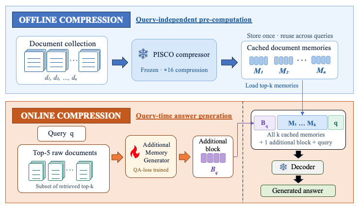

# 2장 2·3절: 압축 컨텍스트의 다중 증거 보완(Additional Memory)과 응답시간 향상

[← 전체 연구 개요로 돌아가기](../README.md)

## 연구 개요

본 연구는 **다중 과학기술 문헌을 제한된 컨텍스트 예산 내에서 효율적으로 활용하면서 질의응답 성능을 유지·개선하는 방법**을 다룹니다. RAG에서 검색된 문헌을 원문 그대로 생성 모델에 입력하면 문헌 수에 따라 입력 길이와 연산 부담이 증가합니다. 이를 완화하기 위해 문서별 정보를 짧은 연속 벡터 표현(memory)으로 압축하는 soft context compression을 활용할 수 있습니다.

그러나 기존 압축 방식은 압축 과정에서 질의응답에 필요한 세부 정보가 손실되거나, 압축 표현에 남아 있는 여러 증거가 최종 답변 생성 과정에서 충분히 활용되지 못하는 한계가 있습니다. 특히 여러 문헌에 분산된 증거를 함께 활용해야 하는 다중 증거 질의응답(Multi-evidence QA)에서 이러한 문제가 두드러집니다. 원문과 PISCO 압축 입력의 성능 비교에서도 단일 증거 데이터셋인 NQ의 성능 차이는 4.8%p인 반면, 다중 증거 데이터셋인 MuSiQue에서는 15.1%p의 차이가 나타났습니다.

이에 본 연구는 기존 PISCO(`naver/pisco-mistral`, 16배 압축)의 문서별 압축 표현을 유지하면서, 질의에 필요한 정보를 보완하는 **추가 메모리 블록(Additional Memory)**을 결합하는 방법을 제안합니다. 기존 압축 표현은 사전에 계산하여 캐시하고, 질의 시점에는 질문과 상위 5개 문서 원문을 바탕으로 추가 블록 1개만 생성합니다. 이를 통해 기존 압축 표현의 재사용성을 유지하면서 다중 증거 질의응답 성능을 개선하고, 긴 입력에서의 응답시간 및 연산 부담을 줄이고자 합니다.

## 방법 개요

1. **Offline Compression — 문서별 사전 압축 및 캐싱**
   - 각 문서를 PISCO 압축기로 독립적으로 압축하여 문서별 memory를 생성합니다.
   - 압축 표현은 질의에 의존하지 않으므로 사전에 캐시하고 여러 질의에서 재사용할 수 있습니다.

2. **Online Augmentation — 질의 시점의 선택적 정보 보완**
   - 검색된 전체 k개 문서에 해당하는 cached memory를 불러옵니다.
   - 질문과 상위 5개 문서 원문(검색 문서가 5개 미만이면 해당 문서 전체)을 추가 블록 생성기에 입력하여 Additional Memory 1개를 생성합니다.
   - 추가 블록 생성기는 QA loss를 이용하여 별도로 학습하며, 기존 PISCO 압축기와 디코더는 고정합니다.

3. **Answer Generation — 보완된 컨텍스트를 활용한 응답 생성**
   - 기존 k개의 문서별 memory 뒤에 추가 블록 1개를 연결합니다.
   - 결합된 압축 컨텍스트와 질문을 디코더(Mistral-7B)에 입력하여 최종 답변을 생성합니다. 기본 QA 실험에서는 k=5이며, 문서 수를 늘리는 실험에서도 추가 블록 생성에 사용하는 원문 범위는 상위 5개로 제한합니다.

## 모듈 모식도

<p align="center">
  
</p>

## 연구 및 평가 항목

본 연구는 단순히 컨텍스트 압축률을 높이는 데 그치지 않고, 압축 표현의 활용성과 질의응답 정확도, 응답 효율 사이의 균형을 개선하는 데 초점을 둡니다.

- **압축 표현의 한계 분석:** 단일·다중 증거 QA에서 원문과 압축 컨텍스트의 성능 차이를 비교하고, 개별 증거 활용 실패와 증거 간 결합 실패를 분석합니다.
- **Additional Memory의 효과 평가:** 원문 입력, PISCO Baseline, Decoder LoRA, Baseline-6 memory와 제안 방법(OURS)을 비교하여 추가 블록의 효과와 단순한 압축 단위 증가의 효과를 구분합니다.
- **문서 수 증가에 따른 성능 평가:** KISTI multi-evidence QA에서 입력 문서 수를 늘리면서 원문 및 압축 입력의 질의응답 성능을 비교합니다.
- **응답 효율 평가:** 압축 표현의 사전 캐싱과 제한된 온라인 계산의 효과를 TTFT(Time to First Token), TTIT(Time to Inter Token), Throughput(초당 생성 토큰 수)을 통해 측정합니다.

## 폴더 구조

```text
2-2_3_context_compression/
├── run/                      # 주요 실험 실행 래퍼
│   ├── setup.sh              # 모델 및 공개 데이터 준비
│   ├── train.sh              # 추가 블록 생성기 및 비교군 학습
│   ├── infer.sh              # 영문 벤치마크 추론 및 평가
│   ├── kisti.sh              # KISTI 벤치마크 실험
│   ├── latency.sh            # 응답시간 및 처리량 측정
│   └── summary.py            # 실험 결과 요약
├── scripts/                  # 데이터 준비, 학습, 평가 및 분석 스크립트
├── src/pisco_research/       # 압축 표현 처리, 추가 블록 결합 및 평가 관련 구현
├── reference/                # 모델 및 데이터 참조 manifest
├── requirements.txt          # 기본 실험 의존성
├── requirements-kisti.txt    # KISTI 및 응답시간 실험 의존성
└── README.md
```

`run/`의 스크립트를 통해 주요 실험을 재현할 수 있으며, 개별 실험의 세부 구현은 `scripts/`와 `src/pisco_research/`에서 확인할 수 있습니다. `reference/manifest.json`은 실험 재현을 위한 참조 정보를 제공합니다.

## 실행

```bash
conda create -n pisco-ref python=3.11 -y && conda run -n pisco-ref pip install -r requirements.txt --extra-index-url https://download.pytorch.org/whl/cu124
conda create -n pisco-kisti python=3.12 -y && conda run -n pisco-kisti pip install -r requirements-kisti.txt   # KISTI·응답시간용
bash run/setup.sh      # 모델 다운로드 + 공개 데이터 준비
bash run/train.sh      # 추가 블록 생성기(OURS) + 비교군 Decoder LoRA 학습 (SMOKE=1: 빠른 확인)
bash run/infer.sh      # 영문 벤치마크 추론: 원문 / PISCO / Decoder LoRA / Baseline-6 / OURS
bash run/kisti.sh      # KISTI multi-evidence QA 구축·추론·판정 (KISTI 데이터 필요)
bash run/latency.sh    # 응답시간 TTFT·TTIT·Throughput
python run/summary.py  # 성능·응답시간 표 출력
```

GPU는 `GPU=0`(기본값), KISTI 질문 생성용 32B 모델은 `GEN_GPUS=0,1,2,3`로 지정합니다. `run/`은 실행 래퍼이고,
단계별 원본 코드는 `scripts/`와 `src/pisco_research/`에 있습니다. 결과는 `artifacts/`에 저장됩니다.

## 데이터

데이터와 가중치는 포함하지 않습니다. 공개 데이터는 `run/setup.sh`가 고정 리비전으로 내려받습니다:
HotpotQA(`hotpotqa/hotpot_qa`), 2Wiki(`framolfese/2WikiMultihopQA`), MuSiQue(`dgslibisey/MuSiQue`),
MultiHop-RAG(`yixuantt/MultiHopRAG`), NQ(DPR `biencoder-nq-dev.json.gz`).

KISTI 데이터(논문 원문·QA)는 비공개입니다. 경로는 다음 스크립트 상단 상수에서 바꿉니다:
`scripts/26_kisti_embed.py`(`CORPORA`), `26_kisti_prepare_child125.py`(`KISTI_ROOT`), `26_kisti_prepare_m120.py`·
`28_kisti_multi_evidence.py`(`INDEX_DIR`, `QA_DIR`, 모델 경로), `26_kisti_score.py`·`28_score.py`(`JUDGE_DIR`).

## 결과

| 데이터셋 | 원문 | Baseline (PISCO) | Decoder LoRA | Baseline-6 memory | OURS |
|---|---|---|---|---|---|
| MuSiQue | 0.544 | 0.393 | 0.480 | 0.383 | **0.485** (+9.2%p) |
| MultiHop-RAG | 0.722 | 0.655 | 0.672 | 0.648 | **0.684** (+2.9%p) |
| NQ (단일 증거) | 0.695 | 0.647 | 0.634 | 0.616 | **0.657** (+1.0%p) |
| KISTI multi-evidence QA | 0.698 | 0.439 | 0.477 | 0.404 | **0.495** (+5.6%p) |

| KISTI 문서 수 k | 5 | 10 | 20 | 40 |
|---|---|---|---|---|
| 원문 / Baseline / OURS | 0.698 / 0.439 / 0.495 | 0.579 / 0.368 / 0.404 | 0.481 / 0.288 / 0.354 | 0.474 / 0.249 / 0.270 |

응답시간: 입력 22.6k 토큰(문서 320개)에서 원문 대비 TTFT 7.8배, 처리량 7.2배 (RTX 3090).
영문은 Match(MultiHop-RAG는 yes/no 판정), KISTI는 Qwen2.5-7B 판정 정확도이며 KISTI는 영문 학습 모델을 그대로 적용한 결과입니다.
