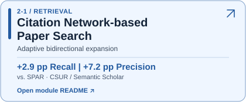
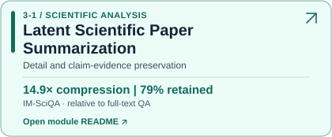
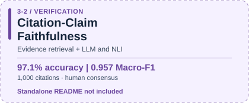

# KISTI_RAG · Scientific RAG

**Technologies for Fast and Efficient Retrieval and Analysis of Multiple Scientific and Technical Documents**

Joint research by **KAIST DM Lab**, **KAIST DISL Lab**, and **KISTI** (Korea Institute of Science and Technology Information).

## Research Overview

본 연구는 다수의 과학기술 문헌에 분산된 지식과 실험 결과를 효율적으로 수집·분석하고, 이를 바탕으로 신뢰성 높은 질의응답 및 서베이 생성을 지원하는 RAG 기술 개발을 목표로 합니다. 기존 RAG는 관련 문헌의 탐색 범위, 긴 컨텍스트의 연산 비용, 압축 과정의 정보 손실, 생성된 주장과 인용 근거의 불일치라는 한계를 갖습니다.

이를 해결하기 위해 두 가지 연구 방향을 중심으로 기술을 개발하였습니다.

- **Efficient Retrieval & Analysis:** 참조·피인용 관계를 활용한 적응형 문헌 검색, 기존 압축 표현에 대한 Additional Memory 보완, 사전 캐싱과 제한된 온라인 연산을 통한 응답시간 개선.
- **Factuality & Faithfulness:** 문헌의 세부 정보와 주장·근거 연결을 보존하는 잠재 표현 기반 요약, 인용-주장 근거 일치성 평가, 구조화된 피드백과 재인용을 활용한 인용 오류 교정.

이러한 기술을 통해 제한된 계산 자원에서도 더 많은 관련 문헌을 활용하고, 생성 결과의 근거를 확인·교정할 수 있는 다중 과학기술 문헌 분석의 기반을 마련하고자 합니다.

## Interactive Research Architecture

아래 모식도에서 연구 모듈을 클릭하면 해당 폴더의 README(방법론, 실행 방법, 실험 결과)로 이동합니다.

<table>
  <tr>
    <td colspan="3" align="center">
      <b>Research Topic / Query</b> 
      ↓ 
       
      ↓ 
      <b>Retrieved Scientific Papers</b>
    </td>
  </tr>
  <tr>
    <td align="center" width="47%">↙ <b>Efficient RAG</b></td>
    <td width="6%"></td>
    <td align="center" width="47%">↘ <b>Scientific Analysis</b></td>
  </tr>
  <tr>
    <td align="center" valign="top">
       
      ↓ <b>Multi-document QA</b>
    </td>
    <td></td>
    <td align="center" valign="top">
       
      ↓ <b>Survey Draft</b> (conceptual stage)
    </td>
  </tr>
  <tr>
    <td colspan="3" align="center"><b>From the Survey Draft</b> ↓ Citation Verification &amp; Refinement</td>
  </tr>
  <tr>
    <td align="center" valign="middle">
      
    </td>
    <td align="center" valign="middle">→ ←</td>
    <td align="center" valign="middle">
      
    </td>
  </tr>
  <tr>
    <td colspan="3" align="center">
      Unsupported citations → refinement; revised claims → re-verification (↺) 
      ↓ <b>Refined Survey</b>
    </td>
  </tr>
</table>

> 위 모식도는 보고서의 연구 기술 간 개념적 관계를 나타냅니다. 각 모듈은 독립적인 연구·실험 단위이며, 전체가 하나의 end-to-end 실행 파이프라인으로 통합되어 있음을 의미하지 않습니다. 3장 2절의 인용 검증 모듈은 별도의 폴더 및 README가 현재 리포지토리에 포함되어 있지 않습니다.

## How the Modules Work Together

각 모듈은 다음과 같이 연결하여 하나의 과학기술정보 분석 및 서베이 작성 지원 과정으로 활용할 수 있습니다.

1. **문헌 탐색 (2장 1절):** 연구 주제 또는 서베이 제목을 입력받아 인용 네트워크의 참조·피인용 관계를 탐색하고, 관련 선행 연구와 후속 연구의 문헌 집합을 확보합니다.
2. **문헌 압축 및 활용 (2장 2·3절, 3장 1절):** 확보한 문헌의 원문을 바탕으로, 다중 문헌 질의응답에는 사전 캐싱된 PISCO 압축 표현과 질의 시점의 Additional Memory를 활용합니다. 서베이 작성 및 세부 분석에는 문단 단위의 잠재 요약을 활용하여 실험 조건, 수치, 결과 및 주장·근거 관계를 보존할 수 있습니다. 두 압축 기술은 목적에 따라 선택할 수 있는 상호 보완적 연구 모듈입니다.
3. **근거 검증 및 교정 (3장 2·3절):** 확보한 문헌의 정보를 종합해 생성한 서베이 초안의 각 인용 문장을 해당 참고문헌 원문과 대조합니다. LLM과 NLI를 통해 확인된 비지지 인용은 Feedback-then-Refine에 전달하여 문장 수정 또는 재인용을 수행하고, 필요시 인용을 삭제합니다. 수정·재인용된 주장은 다시 검증하여 근거 일치성을 높입니다.

이와 같이 문헌 검색 결과는 압축·분석의 입력이 되는 동시에 생성 결과의 검증과 재인용에 활용할 수 있는 근거 자료가 됩니다. 향후 통합 시에는 문헌 식별자, 원문 및 문단 정보, 주장-참고문헌 쌍과 검증 결과를 모듈 간에 연결하여 검색부터 생성·교정까지의 흐름을 구성할 수 있습니다.

현재 각 모듈은 독립적으로 실험되었으며, 3장 3절의 교정 모듈은 3장 2절에서 산출한 비지지 인용 데이터(`unsupported.jsonl`)와 참고문헌 원문을 입력으로 사용합니다. 위의 전체 연계 과정은 연구 결과를 활용한 통합 시나리오이며, 통합 파이프라인의 성능을 별도로 검증한 결과는 아닙니다. 3장 1절의 압축 요약 기술은 IM-SciQA 다중 문헌 질의응답을 통해 평가하였습니다.

## Research Highlights

| 보고서 | 연구 항목 | 주요 실험 결과 |
| --- | --- | --- |
| 2장 1절 | Citation Network-based Paper Search | CSUR 100편, Semantic Scholar 기준 SPAR 대비 Recall **+2.9%p**, Precision **+7.2%p** |
| 2장 2절 | Context Compression & Augmentation | PISCO 대비 MuSiQue **+9.2%p**, KISTI multi-evidence QA **+5.6%p** |
| 2장 3절 | Cached Context & Response Efficiency | 22.6k 입력 토큰에서 원문 대비 TTFT **7.8×**, Throughput **7.2×** |
| 3장 1절 | Latent Scientific Paper Summarization | IM-SciQA **14.9×** 압축, 정답률 **0.564** (전문 입력 성능의 약 79%) |
| 3장 2절 | Citation-Claim Faithfulness | 인용 1,000건의 사람 합의 판정 대비 정확도 **97.1%**, Macro-F1 **0.957** (보고서 기준) |
| 3장 3절 | Feedback-then-Refine | 초기 비지지 인용 1,000건에서 5회 반복 후 비지지 비율 **100% → 26.1%** (삭제 1.1% 포함) |

각 결과는 해당 모듈의 평가 데이터 및 실험 조건에 따른 값입니다. 서로 다른 평가 지표를 직접 비교하지 않습니다.

## Research Modules

| 보고서 장·절 | 모듈 및 실행 문서 | 내용 |
| --- | --- | --- |
| 2장 1절 | [Paper Search Agent](./1-1_paper_search_agent/README.md) | 인용 네트워크의 참조·피인용 방향 적응형 탐색 |
| 2장 2·3절 | [Context Compression](./2-2_3_context_compression/README.md) | PISCO 캐시, Additional Memory, QA 및 응답시간 평가 |
| 3장 1절 | [Latent Scientific Paper Summarization](./3-1_latent_scientific_paper_summarization/README.md) | 문단 단위 잠재 요약, 세부 정보 및 주장·근거 연결 보존 |
| 3장 2절 | Citation-Claim Faithfulness (별도 모듈 미포함) | 근거 문단 검색, LLM과 NLI 결합 판정 |
| 3장 3절 | [Feedback-then-Refine](./3-3_feedback_then_refine/README.md) | 구조화 피드백, 수정·재인용·삭제 및 반복 재검증 |

## Reproducibility

각 모듈의 README에서 의존성 설치, 데이터 준비, 학습, 추론 및 평가 방법을 확인할 수 있습니다. 모듈별 실행 환경과 데이터 요구 사항이 다르므로 개별 안내를 참고하세요.

KISTI 제공 비공개 데이터, 일부 문헌 원문 및 모델 가중치는 리포지토리에 포함되어 있지 않습니다. 데이터 사용 권한 및 공개 범위는 개별 모듈 안내와 해당 데이터의 이용 조건을 따릅니다.

## Acknowledgements

본 연구는 한국과학기술정보연구원(KISTI)의 위탁(공동)연구과제 「다중문서 분석 및 생성을 위한 RAG 기술 연구」의 연구 결과입니다.
